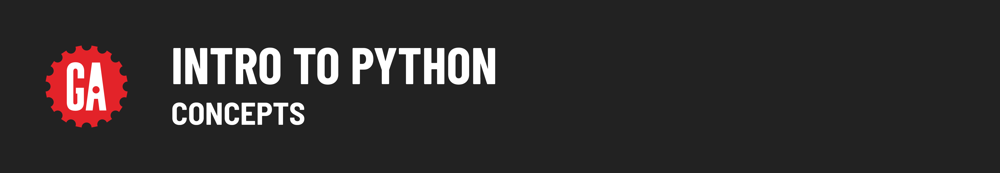

# 

**Learning objective:** By the end of this lesson, students will be able to give a brief description of the Python language.

## History

The Python programming language started in December 1989 as a hobby project for Dutch programmer Guido van Rossum. He was looking for a programming project to keep himself occupied during his Christmas break.

Python was first released to the public in 1991.

## Versions

Ten years after its release, Python 2.0 was introduced with many major new features and it started to gather a community dedicated to its development.

Python 3.0 was released in December 2008.

Version 3.0 introduced many enhancements, however, it included changes that made Python 3 incompatible with much of the existing 2.0 code.

Version 2.0 was [**sunset on January 1, 2020**](https://www.python.org/doc/sunset-python-2/) and is no longer receiving updates. Because of this, it should not be used.

## Type of Language

Python, like JavaScript, is a high-level interpreted programming language.

High-level means that Python is designed for writing applications vs. lower-level software such as operating systems and device drivers. It also means that programmers don’t have to worry about things like memory management.

Also like JavaScript, Python is a dynamic scripting language that does not have to be compiled before it can be executed - it runs within an _interpreter_ that handles the conversion into machine code.

Python comes with a large standard library and is suitable for many types of programming tasks from web development to machine learning.

However, if Python does not include the functionality that you need, there is a huge repository, the [**Python Package Index**](https://pypi.org/), with over 390,000 third-party packages available for use.

## Syntax & Semantics

Python was designed to be an easy-to-read programming language.

Its formatting is visually uncluttered and it often uses English keywords where other languages use punctuation or symbols. For example, the equivalent of JavaScript’s `&&` operator in Python is `and`.

Unlike many other languages, it does not use curly braces to define blocks of code, instead, it uses indentation.

For these and many other reasons, you will find the language easy to learn and code in right away.
